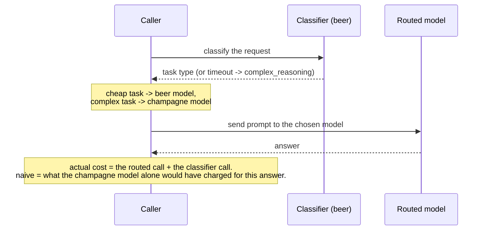
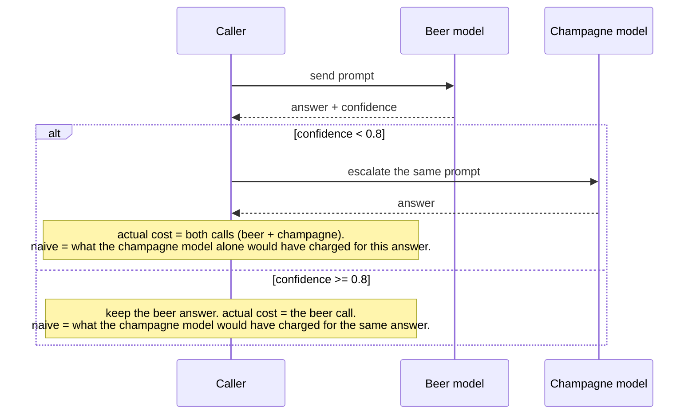
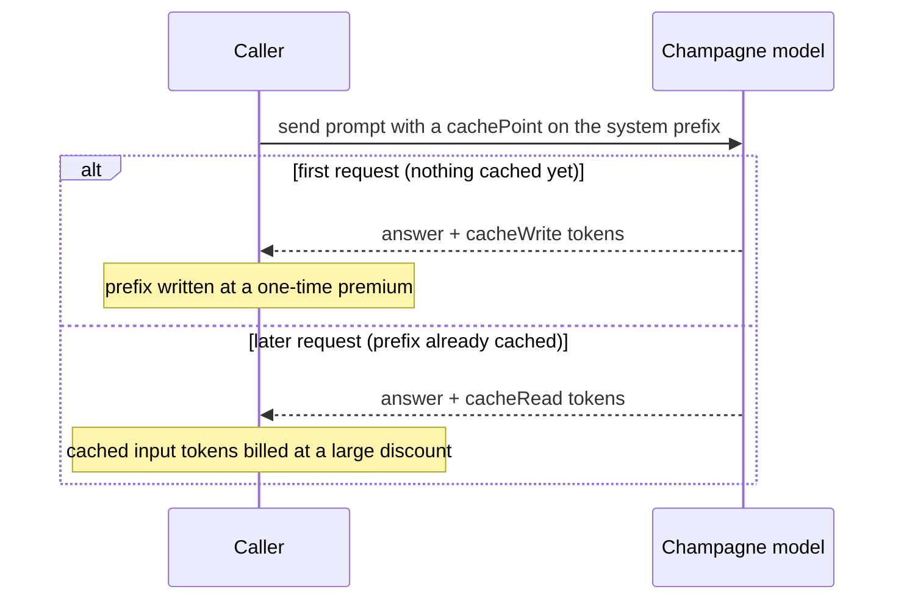
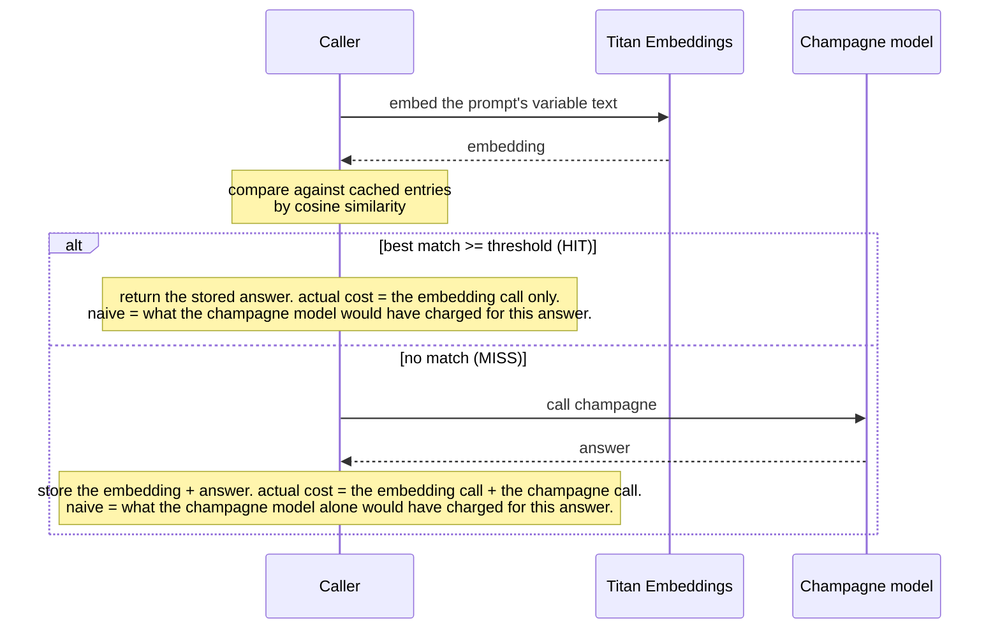
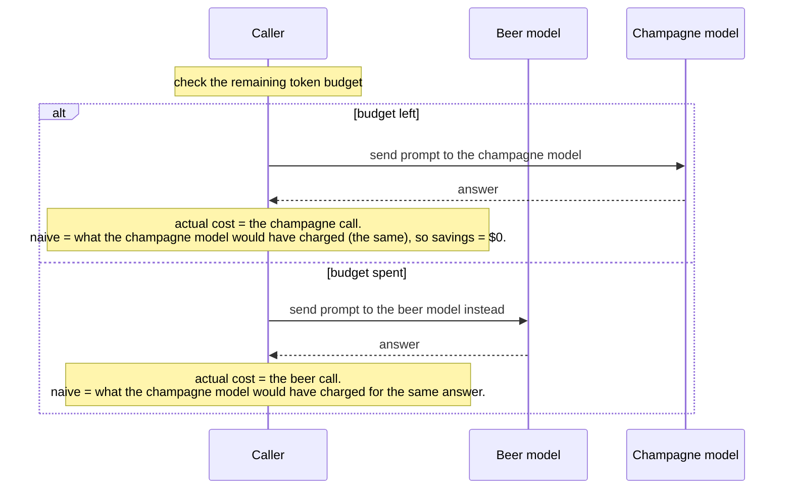
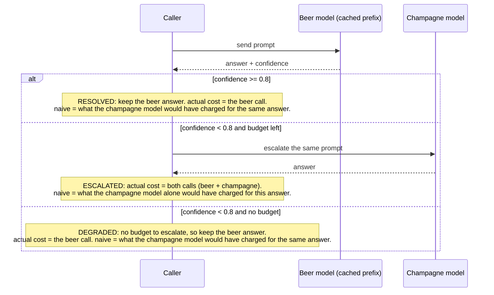

# LLM cost optimization: techniques and tradeoffs

This document is a general guide to reducing the cost of an LLM workload. Each
technique here is a pattern you can apply to any application, not just this one.
The demo files in this repo (`0*_*.py`) are one worked example of each pattern,
and the sequence diagrams below trace what happens to a single request in each.

The guide is deliberately light on specific dollar figures. Prices change, and
the exact numbers for this demo's models say little about your workload. What
carries across workloads is the *shape* of each tradeoff: what you give up to
save money, and the conditions under which the trade is worth it.

## The core idea

Most LLM applications start the same way: every request goes to the most capable
model available, regardless of how hard the request actually is. That is simple
to build and expensive to run, because the hardest request and the most trivial
one pay the same premium.

Almost every cost optimization is a variation on one of two moves:

1. **Use a cheaper model when the task allows it.** Routing, cascading, and
   budget-based degradation all decide, per request, that a smaller model is
   good enough.
2. **Avoid the model call entirely when you already know the answer.** Prompt
   caching and semantic caching both reuse prior work instead of paying for it
   again.

A production system usually combines both. The final pipeline in this repo does.

One principle governs everything below: **none of these techniques is free.**
Each trades away some quality, some latency, or some operational complexity in
exchange for lower cost. The engineering task is to decide which trades your
workload can absorb, and you cannot make that decision well without measuring
quality. That is why the second half of this document is about evaluation.

---

## Model routing

Classify each request first, then send it to the model sized for that class of
work. Cheap, well-defined tasks go to a small model; hard, open-ended reasoning
goes to a large one.

**Why it saves.** The distribution of real traffic is usually skewed. A large
fraction of requests are routine (classify this, extract that, summarize this)
and a small fraction are genuinely hard. Paying premium prices for the routine
majority is pure waste. Routing spends the premium only where the difficulty
justifies it.

**How you'd implement it.** You need a classifier that labels each request, and
a policy that maps labels to models. The classifier can be a small model, a
heuristic, or a lightweight fine-tuned model; the cheaper and faster it is, the
less it eats into the savings. The policy is usually a static table you own and
tune. Make the classifier's failure mode safe: if it errors or times out,
default to the capable model rather than risk a wrong answer.

**Tradeoffs.**
- The classifier adds a call and its latency to *every* request, including the
  ones that were going to the cheap model anyway. If the classifier is not much
  cheaper than the work it routes, the overhead can erase the savings.
- Misclassification is a quality risk in one direction: sending a genuinely hard
  request to a model that cannot handle it. The reverse error (sending an easy
  request to the big model) only costs money.
- The routing policy is a fixed mapping you maintain by hand. It does not
  update itself, so as the kinds of requests you receive change over time, or
  as you add new features that send new kinds of requests, the mapping falls
  out of date and someone has to revisit it.

**When to consider this approach.** Task types are distinguishable up front, and the mix
is skewed toward easy work. Skip it when nearly every request is hard (there is
nothing to route down to) or when tasks are so varied that a classifier cannot
reliably label them.

---

## Model cascading

Send every request to the cheap model first and ask it to signal how confident
it is. Accept the cheap answer when confidence is high; escalate to the capable
model only when it is low.

**Why it saves.** Routing decides difficulty *before* seeing the answer, using a
classifier's guess. Cascading defers the decision until *after* the cheap model
has actually attempted the work, so it can act on the attempt itself rather than
a prediction about it. When the cheap model resolves most traffic, you rarely
pay for the expensive one.

**How you'd implement it.** You need a signal that a cheap answer is
untrustworthy, and a threshold on it. The signal can be model self-reported
confidence, a separate verifier, a schema or validation check on the output, or
a downstream failure. Requests below the threshold get re-run on the capable
model with the same input.

**Tradeoffs.**
- The whole scheme rests on the trustworthiness of the confidence signal, and
  self-reported confidence is often poorly calibrated. A model that is
  confidently wrong defeats cascading entirely: it reports high confidence, you
  accept the bad answer, and you never escalate. Treat the signal itself as
  something to measure, not assume.
- Escalated requests cost *more* than going straight to the capable model,
  because you pay for both attempts. Cascading is a net win only when the
  escalation rate is low enough that the savings on resolved requests outweigh
  the double-pay on escalated ones.
- Latency grows on escalation: an escalated request waits for two sequential
  calls instead of one.

**When to consider this approach.** The cheap model genuinely handles the bulk of your
traffic, and you have a reliable, cheap way to detect a weak answer. Skip it
when the cheap model rarely succeeds (you will escalate constantly and pay
twice) or when you cannot trust any available confidence signal.

---

## Native prompt caching

Mark the stable prefix of your prompt (system instructions, shared context) as
cacheable. The provider stores the processed prefix and reuses it on later
requests, charging a reduced rate for the cached portion.

**Why it saves.** Many applications resend the same large block of context on
every request: a detailed system prompt, a policy document, few-shot examples.
Reprocessing identical tokens every time is redundant work. Caching pays to
process that prefix once and then serves it at a discount.

**How you'd implement it.** Identify the portion of your prompt that is
byte-identical across requests and place it first, then mark the cache boundary
after it. Order matters: everything before the boundary must be stable, and the
variable per-request content goes after it. The discount applies to reads
against a warm cache.

**Tradeoffs.**
- It only helps a prefix that is both large enough to matter and reused often
  enough to stay warm. Provider caches have a minimum cacheable size and a
  limited lifetime, so a prefix that is too small or reused too infrequently
  saves nothing.
- Writing the cache typically carries a premium over a normal call. If reuse
  does not actually happen within the cache lifetime, you pay the write premium
  and never recover it, so caching can cost *more* than not caching.
- Cache scope is narrow in practice (tied to a specific model, region, or
  tenant). It does not help across a fleet of different models or a long tail of
  one-off prompts.

**When to consider this approach.** A substantial, fixed prefix is hit frequently and
predictably. Skip it when prompts are mostly unique, when the shared portion is
small, or when traffic is too sparse to keep a cache warm.

---

## Semantic caching

Before calling the model, check whether you have already answered a
*semantically similar* request. Embed the incoming request, compare it to
embeddings of past requests, and if one is close enough, return the stored
answer without calling the model at all.

**Why it saves.** Prompt caching only matches identical prefixes. Semantic
caching matches identical *meaning*. Two requests worded differently but asking
the same thing can share an answer, and on a hit you skip the generation call
entirely (not just the input side of it), so both input and output cost
disappear.

**How you'd implement it.** You need an embedding model, a store of past
(embedding, answer) pairs, a similarity metric (cosine is typical), and a
threshold above which a match counts as a hit. On a miss you call the model and
add the new pair to the store. Two operational details matter at any scale:
concurrency (two threads seeing the same novel request must not both pay for a
generation, so the read-and-reserve step needs to be atomic) and eviction (the
store cannot grow forever).

**Tradeoffs.**
- Correctness is the central risk, and it is different in kind from the other
  techniques. Routing or cascading to a weaker model still produces a *fresh*
  answer to *this* request. A semantic cache hit returns an answer produced for
  a *different* request that was merely similar. If the threshold is too loose,
  you confidently serve answers to questions nobody asked.
- The threshold is workload-specific and fragile. The right cutoff depends on
  how your embedding model spreads out *your* prompts, and a value tuned on one
  corpus will not transfer to another. (This repo is a small example of that:
  its shared config sets a similarity cutoff that, measured against the repo's
  own prompts, turned out to be too loose. Genuinely different requests scored
  as similar as some true matches, so the semantic-cache file raises the cutoff
  to keep them apart.)
- Cached answers go stale. If the underlying facts change, the cache keeps
  serving the old answer until something evicts it.
- You take on new infrastructure: an embedding call on every request, a vector
  store, and similarity search that must itself stay fast as the store grows.

**When to consider this approach.** High-repetition, low-variance question answering where
an approximate match is genuinely acceptable and the answers are stable over
time. Skip it when requests are mostly unique, when answers must be exact or
fresh, or when serving a near-miss answer carries real risk.

---

## Budget controls and graceful degradation

Track spend against a ceiling. While budget remains, serve requests on the
capable model. Once the ceiling is reached, degrade to a cheaper model instead
of rejecting requests.

**Why it saves.** This is a control mechanism more than an efficiency one. Its
job is to make cost *bounded and predictable* rather than minimal. It protects
against the tail risk of a traffic spike or a runaway loop turning into a
runaway bill.

**How you'd implement it.** You need a running measure of consumption (tokens,
requests, or dollars), a limit, and a policy for what happens at the limit.
Degradation to a cheaper model keeps the service available; alternatives are
queuing, rejecting, or alerting. A hard "everything to the cheapest model"
switch is worth having for emergencies. Because consumption is shared across
concurrent workers, the counter needs safe concurrent updates.

**Tradeoffs.**
- Degradation trades quality for availability, and that is not always the right
  default. For some workloads a degraded answer is worse than no answer, and you
  would rather reject or queue than silently lower quality.
- A token or request budget is a proxy for dollar cost, not the cost itself.
  Different models and cached vs uncached tokens have different real prices, so a
  single token counter is an approximation.
- Enforcing a shared budget across workers requires shared, synchronized state,
  which adds coordination cost and a potential bottleneck.

**When to consider this approach.** A hard spending ceiling matters more than uniform
quality, or you need a safety net against cost spikes. Skip the *degradation*
form when quality is non-negotiable, though you may still want the budget as a
pure alert-and-stop control.

---

## The full pipeline

The techniques compose. A realistic production system layers several of them:
cache the stable prefix, cascade for model selection, and gate escalation behind
a budget.

**Why combine them.** Each technique attacks a different source of waste, so
their savings are largely additive. Caching removes redundant prefix processing;
cascading removes unnecessary premium calls; the budget bounds the worst case.
Together they reach cost reductions no single technique achieves alone.

**Tradeoffs.**
- The layers interact, sometimes helpfully and sometimes not. The cached prefix
  makes the cheap cascade attempt cheaper; the budget can suppress escalations
  that quality actually needed. You have to reason about the combination, not
  just each part.
- Behavior is no longer single-path. A request can resolve, escalate, or
  degrade, and each path has different cost and quality. That is more states to
  test, monitor, and explain.
- Debugging is harder. When a bad answer ships, you have to work out which layer
  produced it.

**When to consider this approach.** This is the shape most production systems end
up with. Get there by adding one technique at a time and evaluating each on its
own before combining them. If you stack techniques you have never tested
individually and quality drops, you will not be able to tell which layer caused
it.

---

## Model evaluation: the backbone

Every technique above trades quality for cost. That makes evaluation the
precondition for all of them. You cannot choose a routing
policy, a cascade confidence threshold, or a semantic-similarity cutoff without
a way to measure what each choice costs you in quality.

### Start with an evaluation set

You need a fixed set of representative inputs paired with either known-good
outputs or explicit acceptance criteria. This set is the ground truth every
tuning decision is measured against.

- **Make it representative.** It should mirror the real distribution of your
  traffic, including the hard and rare cases, not just the easy majority. If your
  eval set contains only easy inputs, a configuration that fails on hard inputs
  will still score well, so the eval passes and the failure only shows up in
  production.
- **Source it from reality.** Production logs (with appropriate handling of
  sensitive data) are the best source of realistic inputs. Expert review
  provides the labels where a correct answer is not mechanically checkable.
- **Keep it current.** Input distributions drift as your product and users
  change. A stale eval set slowly stops describing your actual workload, so
  budget for refreshing it.

### Choose metrics that fit the task

There is no single quality number. Match the metric to the kind of output:

- **Deterministic scoring** where a correct answer exists: exact match,
  precision/recall/F1 for classification and extraction. 
- **Reference-based or rubric scoring** for generation with a known target:
  compare against a reference answer, or score against an explicit rubric
  (did it include the required elements, follow the format, avoid forbidden
  content).
- **LLM-as-judge** for open-ended output with no single right answer. A capable
  model scores the output against criteria. It scales far better than human
  review, but state its caveats plainly: judges have biases (toward length,
  toward their own family of models), the judge itself costs money, and the
  judge needs its own validation against human labels before you trust it.

It's often best to combine these options by using a deterministic check for what can be
checked mechanically, plus a judged or human score for the rest.

### Evaluate each optimization on its own terms

The generic quality number is necessary but not sufficient. Each technique has a
specific failure mode that needs its own measurement:

- **Routing:** measure the classifier directly (a confusion matrix over task
  types), and separately measure the quality delta between the answer the routed
  cheap model gave and the answer the capable model would have given. A perfect
  classifier that routes to a model which still underperforms is not a win.
- **Cascading:** measure the *calibration* of the confidence signal, which is
  the linchpin. Bucket requests by reported confidence and check whether
  accuracy actually rises with it. If "high confidence" does not track "correct,"
  the threshold is meaningless. Then tune the threshold against the eval set,
  trading escalation rate (cost) against resolved-answer quality.
- **Semantic caching:** measure hit *precision*, meaning how often a hit returns
  an answer that is actually right for the new request, not just how often you
  get a hit. Sweep the similarity threshold and plot hit rate against
  wrong-answer rate. The correct threshold is the one that captures reuse
  without crossing into serving mismatched answers, and it is specific to your
  embedding model and corpus.
- **Budget degradation:** measure the quality delta on the degraded path, per
  task type, so you know exactly what you sacrifice when the budget runs out.
  That tells you whether degradation is an acceptable policy or whether some task
  types should reject rather than degrade.

### Think in terms of a cost/quality frontier

Each of these knobs (which tasks route down, the confidence threshold, the
similarity cutoff, the budget) is a dial, not a switch. Turning it trades cost
against quality, and there is no single correct setting. You are picking where
on that trade you want to sit.

The disciplined process is: define your quality bar first, sweep each knob
across its range while measuring both cost and quality on the eval set, plot the
results, and then pick the lowest-cost operating point that still clears the bar.
Optimizing without a stated quality bar has no stopping condition, so the bar
comes first.

### Offline first, then online

Evaluation happens in two stages, and you need both:

- **Offline**, before shipping: run candidate configurations against the eval
  set in batch. This is where you sweep thresholds and pick operating points,
  cheaply and repeatably, with no user exposure.
- **Online**, after shipping: the eval set never fully captures live traffic, so
  monitor quality in production with sampled scoring and guardrail metrics, and
  watch for drift. When you change a threshold, roll it out behind a shadow test
  or an A/B comparison rather than flipping it for everyone at once. Cost and
  quality should be watched together, since a sudden cost drop is often a quality
  regression in disguise (a cache serving too many stale hits, a cascade that
  stopped escalating).

---

## Putting it together

Add these techniques one at a time rather than turning them all on at once.
Evaluate each in isolation, confirm it clears your quality bar, then combine it
with the others and re-evaluate the combination. Revisit the whole stack as your
traffic shifts and as new models change what is available, because the right
settings today may not be the right ones a year from now.

For the concrete, ordered progression of techniques as applied in this repo,
see the "cost optimization progression" section of the [README](../README.md).
