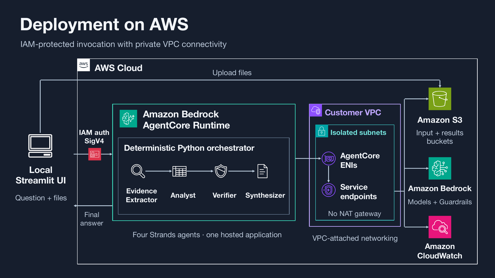
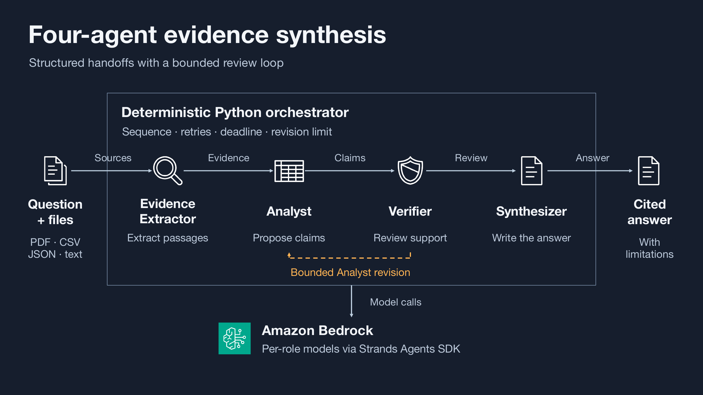
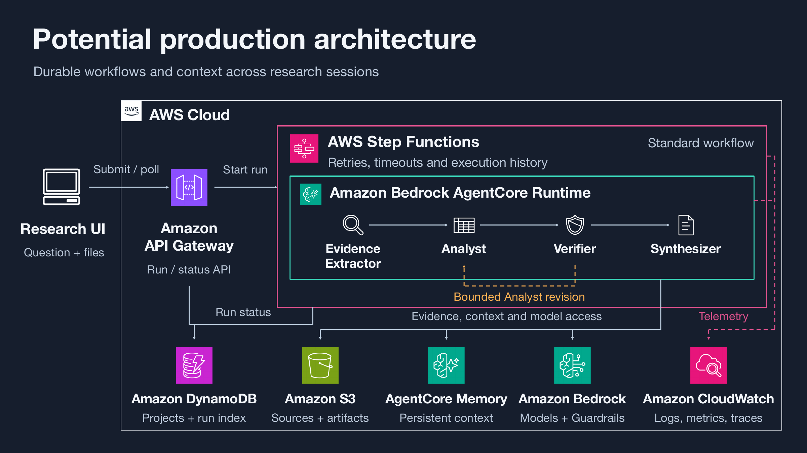

# Four agents, one answer

Turn a question and a collection of files into a cited answer with explicit limitations.
This Python sample uses four agents to extract evidence, propose claims, verify their
support, and synthesize the result. It accepts PDF, CSV, JSON, Markdown, and text files,
with bundled examples for climate resilience, employment revisions, and airline performance.

The application runs on Amazon Bedrock AgentCore Runtime, uses Strands Agents with
Amazon Bedrock models, and includes a local Streamlit UI and command-line tools.

[Deploy](#deploy-to-aws) · [Streamlit UI](#run-the-streamlit-ui) ·
[Command line](#run-from-the-command-line) · [Execution options](#execution-options) ·
[Configuration](#configuration)

## Architecture



The UI uploads source files to S3 and invokes the IAM-protected runtime. A Python
orchestrator runs the agents in sequence and returns one final JSON result. S3 stores
safe run summaries and answers; CloudWatch supplies logs and metrics. The UI polls these
separately to show progress.

## Deploy to AWS

### 1. Prepare your environment

You need Python 3.12, `uv`, Node.js/npm, the AWS CLI, and an authenticated AWS profile.
Run these commands from the repository root after cloning or downloading the sample:

```bash
uv sync --locked --all-extras --group infra
source .venv/bin/activate
npm ci --prefix infra

export AWS_PROFILE=your-profile
export AWS_REGION=us-east-1
export EVIDENCE_SYNTHESIS_REGION=us-east-1
aws sts get-caller-identity
```

Use a profile with permission to bootstrap CDK and deploy the stacks, including IAM
resources and the AgentCore service-linked role. If your profile uses IAM Identity
Center, sign in with `aws sso login --profile your-profile` first.

Confirm that your account can invoke the models selected in
[`StrandsSettings`](src/evidence_synthesis/config.py). CDK reads those defaults;
optional context values in [`infra/cdk.json`](infra/cdk.json) override them.
The supplied deployment targets `us-east-1` and resolves the configured physical
Availability Zone IDs to your account's AZ names. Review region, model, and AZ support
before changing that configuration.

### 2. Bootstrap and deploy

Replace the account ID and operator ARN below. `OperatorPrincipalArn` is the
**same-account IAM user or role ARN** that will run the UI. For an assumed role,
use its IAM role ARN, including any path, rather than the STS session ARN printed
by `get-caller-identity`.

```bash
cd infra

npx cdk bootstrap aws://YOUR_ACCOUNT_ID/us-east-1
npx cdk synth --strict
npx cdk diff --all
npx cdk deploy EvidenceSynthesisFoundation EvidenceSynthesisRuntime \
  --parameters EvidenceSynthesisRuntime:OperatorPrincipalArn=YOUR_IAM_USER_OR_ROLE_ARN \
  --require-approval broadening

cd ..
```

The stacks create an isolated VPC and service endpoints, input/result/access-log S3
buckets, a versioned Bedrock Guardrail, the AgentCore runtime and `live` endpoint,
execution and invocation roles, CloudWatch logging and a dashboard, and SSM parameters
for discovery. The runtime is packaged as a Python 3.12 Linux ARM64 CodeZip. The
bundler uses compatible wheels locally, with Docker available as a fallback.

Deployment incurs AWS charges, including VPC endpoint charges while idle. The foundation
stack has termination protection, and buckets, the Guardrail, and runtime logs are
retained on deletion. See [retention and cleanup](#retention-and-cleanup).

### 3. Allow the operator to discover and invoke the application

The operator must be authorized to read `/evidence-synthesis/*` parameters with
`ssm:GetParameters` and assume the generated invocation role. Find that role in the
`InvokerRoleArn` stack output or the `/evidence-synthesis/invoker-role-arn` SSM parameter.

The stack directly trusts the same-account principal specified by `OperatorPrincipalArn`.
That trust can allow role assumption without a separate identity-policy allowance for
`sts:AssumeRole`; other applicable IAM and organization restrictions still apply.
The stack configures the new role's application permissions but does not modify the
operator's existing identity policies or grant it Parameter Store access.

## Run the Streamlit UI

From the repository root, with the approved operator's AWS profile active:

```bash
source .venv/bin/activate
export EVIDENCE_SYNTHESIS_REGION=us-east-1
scripts/run_ui.sh
```

Open `http://localhost:8501` if the browser does not open automatically.

1. Open the sidebar to select a bundled scenario or upload your own files and question.
2. Leave **Execution mode** set to **Multi-agent** for the four-agent pipeline.
3. Select **Run synthesis**. The UI prepares and uploads the sources, then invokes AgentCore.
4. Explore the **Answer**, **Evidence**, **Claims**, and **Review** tabs.

The UI discovers the deployed resources from SSM and automatically assumes the invocation
role. Opening the page does not call AWS or invoke a model. Stage cards show the latest
available log status: yellow for running, green for complete, and red for failure.
CloudWatch delivery can lag; the answer appears when the invocation and safety checks finish.

The default view uses the coastal-resilience example. Turn off **Presenter mode** in
the sidebar to access AWS overrides, manifest downloads, and separate **Prepare sources**
and **Run analysis** actions. The launcher binds to `127.0.0.1` with CORS and XSRF protection.

## Run from the command line

### Invoke the deployed application

Upload a bundled manifest's source files, then send the resulting S3 manifest to AgentCore:

```bash
python scripts/upload_example.py \
  --manifest examples/coastal-resilience/manifest.json \
  --output /tmp/coastal-resilience-s3.json \
  --region us-east-1

python scripts/invoke_runtime.py \
  --manifest /tmp/coastal-resilience-s3.json \
  --region us-east-1
```

The first command prints the generated manifest's location; the second prints the final
JSON state, including the answer and metrics. Substitute another bundled manifest to
change the question and sources.

**These CLI helpers use the active AWS identity directly.** They do not automatically
assume the UI's invocation role. That identity needs `ssm:GetParameter` for discovery,
`s3:PutObject` on the selected input prefix, and `bedrock-agentcore:InvokeAgentRuntime`.
Explicit `--bucket` and `--runtime-arn` values avoid SSM discovery. The generated UI role
permits uploads only under `sources/ui/*`; use `--prefix sources/ui/cli` if uploading
with that role. The default upload prefix is `sources/coastal-resilience`.

### Run an offline example

After the Python dependency install, this exercises the local workflow without AWS
calls or a deployment. You can skip the AWS and CDK setup for this option:

```bash
evidence-synthesis validate \
  --manifest examples/coastal-resilience/manifest.json

evidence-synthesis run \
  --manifest examples/coastal-resilience/manifest.json \
  --runtime deterministic \
  --output runs
```

Read `runs/<run-id>/answer.md` and `state.json`. Deterministic output is a hand-coded
simulation for testing the wiring; it does not demonstrate model reasoning.
The UI offers the same **Offline deterministic** option in its sidebar.

## Execution options

### Single agent or multi-agent

Choose **Single agent** in the UI to have one agent read all loaded source chunks and
produce an answer with citations and limitations. Switching modes retains prepared
sources and clears the prior answer. Mode changes are disabled during a run.

| | Multi-agent (default) | Single agent |
| --- | --- | --- |
| Work | Extract → analyze → verify → synthesize | One agent reads, assesses, and writes |
| Citations | Linked to extracted evidence and reviewed claims | Linked directly to supplied source chunks |
| Results | Answer, Evidence, Claims, Review | Answer, Citations, Limitations |
| Review loop | Bounded Analyst revisions requested by the Verifier | No separate verification stage |

Both modes apply source limits, safety checks, deadlines, token budgets, and bounded
retries. Answers must cite evidence inline, using `[E001]` or `[E001, E002]`;
internal result markup and malformed citations are rejected. Valid citation IDs
establish traceability, not correctness. One agent invocation can include
structured-output repair turns.

For local CLI runs, add `--mode single_agent`. For AgentCore, add
`"execution_mode": "single_agent"` to the request manifest; omitting it selects multi-agent.

### Local orchestration with live Bedrock inference

`--runtime strands` runs the Python application on your workstation and sends model
requests to Bedrock. It does not invoke the deployed AgentCore application.
Set a Guardrail ID and numbered version that your AWS identity can use:

```bash
export AWS_REGION=us-east-1
export BEDROCK_GUARDRAIL_ID=your-guardrail-id
export BEDROCK_GUARDRAIL_VERSION=1

scripts/run_local_strands.sh examples/coastal-resilience/manifest.json \
  --output runs --json

# Use the same local path with one agent.
scripts/run_local_strands.sh examples/coastal-resilience/manifest.json \
  --mode single_agent --output runs --json
```

The wrapper reads shell variables, then `.env`, then Python defaults. Use
`scripts/run_local_strands.sh --show-config` to inspect model and pipeline settings
without invoking Bedrock. Live calls require model invocation and `bedrock:ApplyGuardrail`
permissions; S3 sources also require read permission.

The AgentCore-compatible entry point can also run locally with
`python -m evidence_synthesis.agentcore_app`; POST a `RunRequest` with inline or allowed
S3 sources to `http://localhost:8080/invocations`.

## Example datasets and your own files

| Example | Data and scope |
| --- | --- |
| [Coastal resilience](examples/coastal-resilience/manifest.json) | Illustrative planning evidence in PDF, CSV, JSON, and Markdown |
| [Harris County climate risk](examples/harris-county-climate-risk/manifest.json) | Prepared NOAA, FEMA, environmental-indicator, and Landsat extracts |
| [BLS employment revisions](examples/bls-employment-revisions/manifest.json) | April–June 2025 payroll levels at three ALFRED publication vintages |
| [BTS airline performance](examples/bts-airline-performance/manifest.json) | December 2022 Southwest and Spirit flight outcome counts and definitions |

Review each dataset's notes and `provenance.yml` where provided. These are compact
historical or illustrative fixtures, not live feeds. The BTS counts were transcribed
from official report text; the input files retain the capture and comparison limitations.

For your own data, upload files and enter a question in the UI, or create a local manifest:

```json
{
  "question": "What conclusion is supported by the supplied evidence?",
  "sources": [
    {"source_id": "study", "uri": "data/study.pdf"},
    {"source_id": "results", "uri": "data/results.csv"}
  ]
}
```

Local paths resolve relative to the manifest's directory and must stay inside it.
AgentCore accepts inline content or allowed S3 objects; it cannot read files from your laptop.
No metadata sidecar is required. Existing `source-metadata.json` files remain optional hints.

To upload an entire folder and generate an S3 manifest:

```bash
python scripts/generate_manifest.py \
  --folder path/to/source-files \
  --question "What conclusion is supported by the supplied evidence?" \
  --output /tmp/evidence-s3.json --region us-east-1
```

Alternatively, replace `--folder` with `--s3-prefix s3://YOUR_INPUT_BUCKET/sources/YOUR_CASE/`
to list existing objects. The folder command needs upload permission; the S3-prefix command
needs `s3:ListBucket`. The runtime reads only the objects explicitly named in the manifest.
Use `--bucket`, `--prefix`, and `--max-evidence` to override discovery, destination, and
extraction size. Hidden files, manifests, metadata sidecars, and unsupported formats are skipped.

## How the pipeline works



| Agent | Responsibility |
| --- | --- |
| **Evidence Extractor** | Proposes relevant passages and source descriptions. Code matches excerpts to source chunks and assigns evidence IDs. Reports missing context as gaps. |
| **Analyst** | Builds bounded claims linked to evidence IDs, with confidence assessments and limitations. |
| **Verifier** | Reviews each claim as verified, qualified, or rejected; explains conflicts and may request an Analyst revision. |
| **Synthesizer** | Writes the final cited answer from the reviewed claims, retaining qualifications and unresolved gaps. |

The Synthesizer receives reviewed claims, review reasons, contradictions and gaps.
It generates only the answer and limitations; code validates citation IDs and builds
the citation records and result metadata. Malformed output can be corrected within
the existing two-turn invocation limit before the orchestrator handles a failure.

The [orchestrator](src/evidence_synthesis/orchestrator.py) is ordinary Python. It owns
sequence, retries, deadlines, budgets, and terminal states. Agents exchange
[typed Pydantic models](src/evidence_synthesis/models.py). Internal `async`/`await`
supports timeouts and model calls; AgentCore still returns one final response.

Source profiles help navigate the evidence. Matching an excerpt does not validate its
interpretation, and profiles do not count as additional independent sources.
`citation_closure_complete` controls whether the review loop can finish; it is not a
truth guarantee. `revision_feedback` is the readable property for the serialized
`retry_queries` field. Changes to these contracts require compatible clients and deployment.

## Configuration

Local runs resolve shell variables, `.env`, then defaults in
[`config.py`](src/evidence_synthesis/config.py). Keep `.env` files local.
CDK takes model and token defaults directly from the Python field definitions, ignoring
shell and `.env` values. Override them with context keys such as `verifier_model_id` or
`verifier_max_tokens` in `infra/cdk.json` or `npx cdk ... -c key=value`.
Redeploy `EvidenceSynthesisRuntime` for cloud configuration changes.

| Setting | Python default |
| --- | --- |
| `EVIDENCE_EXTRACTOR_MODEL_ID` | `us.amazon.nova-lite-v1:0` |
| `ANALYST_MODEL_ID`, `VERIFIER_MODEL_ID`, `SYNTHESIZER_MODEL_ID`, `SINGLE_AGENT_MODEL_ID` | `us.anthropic.claude-sonnet-5` |
| `EVIDENCE_EXTRACTOR_MAX_TOKENS` | `4096` |
| `ANALYST_MAX_TOKENS` | `10000` |
| `VERIFIER_MAX_TOKENS`, `SYNTHESIZER_MAX_TOKENS`, `SINGLE_AGENT_MAX_TOKENS` | `15000` |
| `PIPELINE_TOKEN_BUDGET` | `200000` |
| `PIPELINE_DEADLINE_SECONDS` | `300` |
| `PIPELINE_MAX_RETRIES` | `1` retry after a failed stage |
| `PIPELINE_MAX_VERIFICATION_CYCLES` | `2` total review rounds |
| Manifest `max_evidence` | `20`; applies only to multi-agent extraction |

Per-role output caps apply to each model call. The total token budget is checked between
calls, so a call in progress can exceed what remains. Timeouts or unknown usage stop
further calls; `token_usage_complete=false` signals that recorded usage may be incomplete.
The metrics record tokens, latency, attempts, and model IDs, but do not calculate monetary cost.

<details>
<summary>Discovery, storage, and command options</summary>

The UI uses `EVIDENCE_SYNTHESIS_REGION` (default `us-east-1`) for discovery. Other explicit
overrides are `EVIDENCE_SYNTHESIS_RUNTIME_ARN`, `EVIDENCE_SYNTHESIS_ENDPOINT_NAME`,
`EVIDENCE_SYNTHESIS_INPUT_BUCKET`, `EVIDENCE_SYNTHESIS_INVOKER_ROLE_ARN`,
`EVIDENCE_SYNTHESIS_RESULTS_BUCKET`, and `EVIDENCE_SYNTHESIS_RESULTS_PREFIX` (default `runs`).
Blank settings are discovered from `/evidence-synthesis/*` in SSM.

Runtime storage settings are `SOURCE_BUCKET`/`SOURCE_PREFIX` for allowed S3 inputs and
`ARTIFACT_BUCKET`/`ARTIFACT_PREFIX` for results. The deployed runtime restricts reads to
its input bucket's `sources/*` prefix. Local CLI `--output` selects a filesystem artifact store.

| Command | Main options |
| --- | --- |
| `evidence-synthesis validate` | `--manifest` |
| `evidence-synthesis run` | `--manifest`, `--runtime deterministic\|strands`, `--mode multi_agent\|single_agent`, `--output`, `--json` |
| `scripts/upload_example.py` | `--manifest`, `--bucket`, `--prefix`, `--output`, `--region` |
| `scripts/generate_manifest.py` | `--folder` or `--s3-prefix`, `--question`, `--metadata`, `--bucket`, `--prefix`, `--max-evidence`, `--output`, `--region` |
| `scripts/invoke_runtime.py` | `--manifest`, `--runtime-arn`, `--qualifier` (default `live`), `--session-id`, `--region` |

Use each command's `--help` for the complete argument reference. The AgentCore client
uses a 600-second read timeout and one total SDK attempt to avoid duplicate invocations.

</details>

## Safety, limits, and saved results

Live runs require a Bedrock Guardrail ID and version. The same version screens the
question, source text and metadata, and generated answer, including partial answers,
using standalone `ApplyGuardrail`. Missing or failed safety checks block the run.
The offline simulation uses the local safety policy. Guardrails reduce risk without
establishing source trustworthiness or factual correctness.

The UI accepts up to 20 files, 25 MB each, and 100 MB total. The backend independently
limits request JSON to 4 MiB, text/CSV/JSON sources to 1 MB each, PDFs to 25 MiB each,
and total input to 100 MiB. Parsing stops at 100,000 characters or 1,000 chunks.
PDF parsing has a 100-page limit and uses a worker with time and memory limits;
scanned pages need OCR, which this sample does not provide.

Stage artifacts contain progress counts. `answer.md` retains the safety-checked answer;
`state.json` adds metrics and the request fingerprint. Raw source passages, claims,
and detailed reviews are available in the live response but are omitted from saved
progress and recovery files. Strands callbacks and OpenTelemetry content export are
disabled by default. Keep model-invocation content logging disabled unless its access
and retention have been separately approved.

Run IDs are reserved before execution and cannot be reused. Reservations prevent
accidental replacement; they are not a WORM archive or an ownership check. The UI can
recover a saved safe answer after a lost response by matching the request fingerprint.
Log/artifact polling failures do not restart or cancel the original invocation.

This is a non-production sample for one trusted data scope. Separate owners require
separate deployments or added tenant authorization. A remotely hosted UI needs an
authenticated application boundary. Use synthetic or approved data and assess the
privacy, retention, and regulatory requirements of your use case. Guardrail filters
alone do not establish compliance. See the [threat model](docs/threat-model.md) for
controls and remaining risks. Outputs support research and planning, not individual
legal, medical, insurance, financial, or eligibility decisions.

### Retention and cleanup

UI uploads under `sources/ui/*` and run artifacts expire after seven days, including
noncurrent versions. Run-ID reservations do not expire. Other input prefixes, including
the default CLI upload prefix, do not inherit the UI-upload expiry. Access logs expire
after 90 days; runtime logs have 90-day retention. Both data buckets send access logs to
a separate SSE-S3 bucket that does not log to itself.

To remove a deployment, explicitly disable foundation-stack termination protection and
delete the runtime stack before the foundation. Review and remove retained buckets,
objects, Guardrail versions, and log groups separately when they are no longer needed.
Deleting stacks alone does not remove retained data or all associated costs.

## Development and evaluations

Run the offline checks from the repository root:

```bash
PYTHONPATH=src:infra pytest tests infra/tests evals/verifier
ruff check src tests scripts infra/app.py infra/evidence_synthesis_infra infra/tests evals/verifier
mypy
python evals/verifier/validate_dataset.py
```

The [Verifier evaluation guide](evals/verifier/README.md) covers the reviewed dataset,
offline checks, and optional paid Verifier and explanation-judge runs. The sample
uses the Verifier handoff candidate v1 prompt; see the
[results and limitations](evals/verifier/RESULTS.md).
The dataset is a small development set, not a broad reliability benchmark.

Dependencies are pinned in `pyproject.toml` and `uv.lock`. The runtime bundle installs
hash-checked dependencies from `requirements-runtime.txt`; build tools use
`requirements-build.txt`, and the Docker fallback image is pinned by digest. When updating
pins, regenerate the lock and exports, keep `infra/requirements*.txt` aligned, and rerun checks:

```bash
uv lock
uv export --locked --extra aws --no-dev --no-emit-project \
  --output-file requirements-runtime.txt
uv export --locked --only-group build --no-emit-project \
  --output-file requirements-build.txt
```

Start reading the code in these locations:

| Location | Purpose |
| --- | --- |
| [`agents/`](src/evidence_synthesis/agents/) | Role prompts and typed invocations |
| [`orchestrator.py`](src/evidence_synthesis/orchestrator.py), [`single_agent_runner.py`](src/evidence_synthesis/single_agent_runner.py) | Workflow, safety, and execution controls |
| [`models.py`](src/evidence_synthesis/models.py), [`validation.py`](src/evidence_synthesis/validation.py) | Handoff contracts and deterministic relationship checks |
| [`source_loader.py`](src/evidence_synthesis/source_loader.py), [`source_profiles.py`](src/evidence_synthesis/source_profiles.py) | File ingestion and excerpt grounding |
| [`ui/`](src/evidence_synthesis/ui/) | Streamlit, source preparation, and progress polling |
| [`agentcore_app.py`](src/evidence_synthesis/agentcore_app.py), [`strands_runtime.py`](src/evidence_synthesis/strands_runtime.py) | AgentCore entry point and Bedrock model calls |
| [`infra/`](infra/), [`scripts/`](scripts/) | CDK stacks and local helpers |

## Potential production architecture



This is a proposed extension, **not what the supplied CDK stacks deploy**. Step Functions
could own durable orchestration and retries, AgentCore Memory could retain context across
sessions, and an authenticated API with DynamoDB could expose run status independently
of the UI. Tenant isolation, human review, broader evaluations, and source-specific access
controls would also need to match the intended workload.

## License

[MIT](LICENSE). Copyright (c) 2026 Amazon Web Services.
