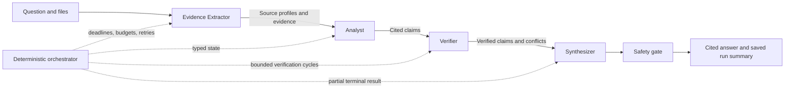

# Four agents, one answer

This repository is a Python sample for a contract-first evidence synthesis
pipeline. It is designed for domains where fragmented structured and unstructured sources
must become a defensible, cited conclusion.

The included climate datasets provide working examples; the pipeline can be adapted to
other domains. Start with files and a question; no source-metadata file is required.
The Evidence Extractor describes the sources and extracts evidence in the same invocation. A generated
or hand-written manifest can point to local files, inline content, or S3 objects containing
JSON, CSV, text, Markdown, or PDF data.

Local file sources must resolve within the manifest's directory; paths and symlinks
that escape it are rejected. AgentCore requests accept inline content or allowed S3
objects and cannot read files from the runtime filesystem.

## Design



The orchestrator is ordinary Python, not a fifth agent. It owns sequence, deadlines, token
budget, retry caps, verification cycles, safety checks, and terminal states. Agents exchange
Pydantic models rather than chat transcripts.

Two runtimes implement the same contracts:

- `deterministic`: offline, predictable, fast, and used for tests and local development.
- `strands`: real Strands Agents using explicitly routed Amazon Bedrock models.

The deployable entry point uses Amazon Bedrock AgentCore Runtime. Live Strands runs require
a Bedrock Guardrail to screen the question, retrieved source text and metadata, and every
generated final answer, including partial answers. Missing or failed safety checks block
the run. The offline deterministic mode uses the local safety policy.

See the [threat-model report](docs/threat-model.md) for the security boundaries,
implemented controls, remaining risks, and assessment results.

## Pipeline implementation

The UI and CLI use the same implementation. Start with
[`orchestrator.py`](src/evidence_synthesis/orchestrator.py) for the workflow,
[`models.py`](src/evidence_synthesis/models.py) for the data contracts, and the
[`agents`](src/evidence_synthesis/agents/) directory for each role's instructions.

The main `run()` method makes the sequence and bounded review loop visible. Named helpers
handle payload assembly, state updates, and persistence. Execution retries remain in `_stage()`.
AgentCore runs the pipeline to completion and returns one JSON state. The backend records
stage logs and artifacts without progress callbacks, event queues, or response streaming.
Internal `async`/`await` remains in place for stage deadlines and calls to the model runtime.

`EvidenceExtractorAgent.extract()` is the extraction API. The role, saved-state field,
artifact filename, UI keys, and configuration all use `evidence_extractor`.
The handoff models are `EvidenceExtractorInput` and `EvidenceExtractorResult`.
Deploy the backend and update local clients together when changing these contracts;
previously saved runs retain their original schema.
`VerificationResult.revision_feedback` provides a readable name for the existing serialized
`retry_queries` field.

## Quick start

Python 3.12 or newer is required.

```bash
python3.12 -m venv .venv
source .venv/bin/activate
python -m pip install -e ".[dev]"

evidence-synthesis validate \
  --manifest examples/coastal-resilience/manifest.json

evidence-synthesis run \
  --manifest examples/coastal-resilience/manifest.json \
  --runtime deterministic \
  --output runs
```

Each run writes `evidence_extractor.json`, `analysis.json`, one or more verification artifacts,
`synthesis.json`, `state.json`, and `answer.md` beneath `runs/<run-id>/`.
Stage artifacts contain progress counts, not raw source passages or model responses.
`state.json` contains the safety-checked answer, metrics, and a request fingerprint;
the full evidence and review are available in the live response only.
An optional `run_id` on `RunRequest` accepts a 32-character lowercase hexadecimal UUID.
The UI generates a fresh ID for each invocation so it can locate artifacts before the
final response arrives. Other callers can omit it and retain server-generated IDs.
The artifact store reserves each run ID before work begins and rejects reuse. S3 reservations
are kept separately from expiring run artifacts; this prevents accidental replacement,
but is not a WORM audit archive or an ownership check.

Run the checks:

```bash
pytest
ruff check .
mypy
```

## Locked dependencies

Use the checked-in lock file for a repeatable development and infrastructure setup:

```bash
uv sync --locked --all-extras --group infra
```

Direct dependencies are pinned to tested versions. AgentCore bundles use
`requirements-runtime.txt` to install the runtime versions from `uv.lock`, with pip hash
verification. `requirements-build.txt` locks the build tools; the Docker fallback image is
pinned by digest. These checks make inputs repeatable; they do not attest package behavior.
When updating dependencies, change the exact pins in `pyproject.toml` and
`infra/requirements*.txt`, regenerate both files, and rerun the tests and security scan:

```bash
uv lock
uv export --locked --extra aws --no-dev --no-emit-project \
  --output-file requirements-runtime.txt
uv export --locked --only-group build --no-emit-project \
  --output-file requirements-build.txt
```

## Streamlit UI

The local dashboard invokes the deployed AgentCore Runtime by default and offers
an explicit offline deterministic mode. It supports the bundled Harris County and
coastal-resilience scenarios plus custom multi-file uploads.

Install and launch it:

```bash
python -m pip install -e ".[aws,ui,dev]"
scripts/run_ui.sh
```

The UI uses the current AWS credential chain to discover the runtime, endpoint, input and
results buckets, and invoker role from SSM. It assumes the invoker role, uploads prepared sources
under `sources/ui/<batch-id>/`, and waits for the final JSON result from AgentCore. The base
identity therefore needs `ssm:GetParameters` and `sts:AssumeRole` for the deployed invoker role.
Blank advanced settings are discovered from SSM; the equivalent
`EVIDENCE_SYNTHESIS_*` environment variables can supply explicit overrides.
`EVIDENCE_SYNTHESIS_REGION` defaults to `us-east-1` independently of any ambient
`AWS_REGION`, preventing unrelated shell configuration from redirecting SSM discovery.

The default interface opens with the coastal-resilience example selected and the
sidebar collapsed. It shows the question, source filenames, plain-language agent
descriptions, and one **Run synthesis** button. It prepares sources automatically when
needed and reuses them for subsequent runs with unchanged inputs. File contents are hashed,
so replacing a file with different same-sized content invalidates preparation and the prior
result. No AWS calls or model invocations happen merely by opening the page.

Open the sidebar and expand its setup controls to select a bundled example, upload your
own files and enter a question, or switch to the **Offline deterministic** simulation.
Use **Prepare sources** to perform discovery and uploads separately from inference.
AWS failures remain visible and never trigger an automatic offline fallback.

Results use four tabs: Answer, Evidence, Claims, and Review. The answer preview
shows the original opening paragraph (except the simulation's repeated question), the
first three supported or qualified claims, and a key caveat when available. This is an
extractive UI preview, not an additional model response. The complete answer, citations,
and limitations remain expandable. Metrics and state downloads live under **Run details**.
The Evidence tab includes generated source descriptions, relevant context, and expandable
supporting passages. These descriptions are interpretation aids, not independent evidence.
The UI's Evidence Extractor label maps to the `evidence_extractor` stage and artifact.

The sidebar's mode toggle switches to the full developer interface, including AWS
overrides, manifest downloads, and all seven result tabs. AWS overrides are retained
when switching views. The developer workflow has two steps:

1. **Prepare sources** validates files, uploads AgentCore inputs when needed, and exposes
   the exact generated manifest for download. It does not infer source descriptions.
2. **Run analysis** invokes AgentCore once in a UI background worker. Every two seconds, a
   Streamlit fragment checks the run's stage logs and saved artifacts. Logs update stage
   colors; artifacts provide stage counts. The final response provides evidence, claims,
   and review results. Both views use the same request-and-result flow.

Stage cards turn **yellow** on a `started` log, **green** on `completed`, and **red** on
`failed` or `timed_out`. A later retry or Analyst revision can turn a card yellow again.
CloudWatch delivery can lag; a short stage may finish before its yellow state is observed.
The UI filters logs by run ID, ignores unrelated loggers, and orders updates by event time
so duplicate or delayed messages cannot roll a completed stage back to an earlier start.
Colors reflect the latest available logs rather than a fabricated percentage.
The final answer is displayed only after the final response and safety checks finish.
Artifact and log polling fail independently; neither cancels or restarts inference.
Page reruns reuse the active invocation,
and run/setup controls are disabled until that invocation returns. If the response is lost
after `state.json` has been saved, the UI can recover the safe answer and metrics after
checking the request fingerprint. Detailed evidence and review are not stored for recovery.

The UI polls `runs/<run-id>/` in the results bucket using prefix-restricted `s3:ListBucket`
and `s3:GetObject` permissions on the invoker role. It reads the existing runtime log group
with `logs:FilterLogEvents`, scoped to that runtime's endpoints. The log group is derived
from the runtime ID and endpoint qualifier. Offline mode captures the same ordinary Python
log messages in the UI and polls artifact files locally.
The backend still returns one JSON response and contains no polling, progress callbacks,
or streaming code. The invocation client uses a 600-second read timeout and one total SDK
attempt so a transport retry cannot silently start a second run.

`EVIDENCE_SYNTHESIS_RESULTS_BUCKET` can override results-bucket discovery; the advanced
configuration includes the same override. `EVIDENCE_SYNTHESIS_RESULTS_PREFIX` defaults to
`runs` and must match the deployed artifact prefix and the invoker's read permissions.

Supported custom files are JSON, CSV, text, Markdown, and PDF. The UI accepts at most
20 source files, 25 MB per file, and 100 MB total. It does not browse prior S3 runs or
silently switch to offline mode after an AWS error.
The backend independently limits requests to 20 sources and 4 MiB of request JSON,
with at most 1 MB per text/CSV/JSON source, 25 MiB per PDF, and 100 MiB of total input.
Parsing stops at 100,000 extracted characters or 1,000 chunks. PDFs have a 100-page limit
and run in a separate worker with time and memory limits. This worker limits resource use;
it is not a separate security sandbox.
The launcher gives the offline fallback a 200,000-token budget and 300-second deadline so
both bundled scenarios can complete.
The UI binds to `127.0.0.1` with CORS and XSRF protection enabled. It is intended for a
trusted workstation. Remote hosting requires an authenticated application boundary.

## Execution modes

The word `runtime` is used in two different ways in this project:

- The CLI `--runtime` option selects the local agent implementation.
- Amazon Bedrock AgentCore Runtime is the AWS service that hosts the complete application.

Selecting `--runtime strands` does not deploy or move the Python process to AWS. The
orchestrator, agents, state, and artifact writing continue to run on the laptop; Strands
sends model inference requests to Amazon Bedrock.

| Mode | Command or entry point | Where the pipeline runs | Model inference |
| --- | --- | --- | --- |
| Validate only | `evidence-synthesis validate` | Laptop | None |
| Deterministic CLI | `evidence-synthesis run --runtime deterministic` | Laptop | Local deterministic implementation |
| Strands CLI | `evidence-synthesis run --runtime strands` | Laptop | Amazon Bedrock |
| Local AgentCore-compatible server | `python -m evidence_synthesis.agentcore_app` | Laptop | Amazon Bedrock |
| Deployed AgentCore Runtime | `python scripts/invoke_runtime.py` | AWS AgentCore Runtime | Amazon Bedrock |

The deterministic mode is useful for tests and local development. The local
Strands mode exercises the real agents and models while keeping the application process
local. The AgentCore mode runs the same Strands-based pipeline inside the deployed AWS
runtime.

### Local CLI commands

Validate the manifest schema without running any agents:

```bash
evidence-synthesis validate \
  --manifest examples/coastal-resilience/manifest.json
```

Run locally without Bedrock:

```bash
evidence-synthesis run \
  --manifest examples/coastal-resilience/manifest.json \
  --runtime deterministic \
  --output runs
```

Run the pipeline locally while using Bedrock for inference:

```bash
export AWS_REGION=us-east-1
export EVIDENCE_EXTRACTOR_MAX_TOKENS=4096
export ANALYST_MAX_TOKENS=6144
export VERIFIER_MAX_TOKENS=8192
export SYNTHESIZER_MAX_TOKENS=4096
export PIPELINE_TOKEN_BUDGET=50000
export BEDROCK_GUARDRAIL_ID=your-guardrail-id
export BEDROCK_GUARDRAIL_VERSION=1

evidence-synthesis run \
  --manifest examples/coastal-resilience/manifest.json \
  --runtime strands \
  --output runs \
  --json
```

Alternatively, use the repository wrapper with tuned local defaults:

```bash
scripts/run_local_strands.sh \
  examples/coastal-resilience/manifest.json \
  --output runs \
  --json
```

The wrapper uses the project `.venv`, can be called from any directory, and sets the
documented model IDs, role-specific output limits, a `200000` pipeline token budget, and a
`180`-second deadline. Existing environment variables override its defaults. Display the
effective configuration without invoking Bedrock:

```bash
scripts/run_local_strands.sh --show-config
```

The local Strands command requires AWS credentials and network access to the configured
Bedrock endpoint. A manifest containing S3 URIs also requires permission to read those
objects.

Run the AgentCore-compatible HTTP entry point locally:

```bash
python -m evidence_synthesis.agentcore_app
```

In another terminal, send inline evidence to the local server:

```bash
curl --request POST http://localhost:8080/invocations \
  --header "Content-Type: application/json" \
  --data-binary '{
    "question": "What does the pilot observation support?",
    "sources": [{
      "source_id": "pilot-notes",
      "content": "The pilot recorded fewer street-flooding reports after drain maintenance."
    }]
  }'
```

Invoke the deployed AgentCore Runtime instead:

```bash
python scripts/invoke_runtime.py \
  --manifest /tmp/coastal-resilience-s3.json
```

### CLI parameters

| Parameter | Applies to | Default | Meaning |
| --- | --- | --- | --- |
| `--manifest PATH` | `validate`, `run` | Required | `RunRequest` JSON containing the question and explicit sources |
| `--runtime` | `run` | `deterministic` | Selects `deterministic` or `strands`; it does not select where the process is hosted |
| `--output PATH` | `run` | `runs` | Local artifact directory |
| `--json` | `run` | Off | Prints the complete `ResearchState` JSON instead of only the answer and summary |

### Model and pipeline configuration

Local CLI runs read these values from the current shell. The deployed AgentCore Runtime
receives equivalent environment variables from
`infra/evidence_synthesis_infra/runtime_stack.py`; exporting a value on the laptop does not
change an already deployed runtime.

| Environment variable | Default | Meaning |
| --- | --- | --- |
| `AWS_REGION` | `us-east-1` | Region used for Bedrock, S3, and Guardrail calls |
| `EVIDENCE_EXTRACTOR_MODEL_ID` | `us.amazon.nova-lite-v1:0` | Evidence Extractor model or inference profile |
| `ANALYST_MODEL_ID` | `us.anthropic.claude-sonnet-5` | Analyst model or inference profile |
| `VERIFIER_MODEL_ID` | `us.anthropic.claude-sonnet-5` | Verifier model or inference profile |
| `SYNTHESIZER_MODEL_ID` | `us.anthropic.claude-sonnet-5` | Synthesizer model or inference profile |
| `EVIDENCE_EXTRACTOR_MAX_TOKENS` | `4096` | Maximum Evidence Extractor output per model call |
| `ANALYST_MAX_TOKENS` | `10000` | Maximum Analyst output per model call |
| `VERIFIER_MAX_TOKENS` | `15000` | Maximum Verifier output per model call |
| `SYNTHESIZER_MAX_TOKENS` | `15000` | Maximum Synthesizer output per model call |
| `PIPELINE_TOKEN_BUDGET` | `200000` | Stop further calls once recorded usage reaches this threshold |
| `PIPELINE_DEADLINE_SECONDS` | `300` | End-to-end orchestration deadline |
| `PIPELINE_MAX_RETRIES` | `1` | Retries allowed after a failed stage |
| `PIPELINE_MAX_VERIFICATION_CYCLES` | `2` | Total verification rounds, including the initial review |
| `SOURCE_BUCKET` | Unrestricted locally | Optional allowed S3 input bucket |
| `SOURCE_PREFIX` | Empty locally | Optional allowed key prefix within `SOURCE_BUCKET` |
| `ARTIFACT_BUCKET` | None | S3 results bucket used when no local output directory is supplied |
| `ARTIFACT_PREFIX` | `runs` | Results prefix in `ARTIFACT_BUCKET` |
| `BEDROCK_GUARDRAIL_ID` | None | Required with a version for live Strands runs |
| `BEDROCK_GUARDRAIL_VERSION` | None | Numbered Guardrail version |

The role-specific `*_MAX_TOKENS` variables and `PIPELINE_TOKEN_BUDGET` are different
controls. Each role-specific value is sent directly to that role's model and must be below
the model's output limit. The pipeline budget is an application cost and execution guard
across Evidence Extractor, Analyst, Verifier, Synthesizer, and retries. The table lists Python
defaults; shell examples and CDK settings may override them.

The manifest's `max_evidence` field is another independent control. It defaults to `20` and
limits how many evidence records the Evidence Extractor passes onward. Lowering it can reduce
Analyst and Verifier input-token usage, at the cost of less evidence coverage.

For a larger run, increase `PIPELINE_TOKEN_BUDGET` independently while leaving
each role's maximum within its selected model's per-call output limit.

For deployed AgentCore changes:

- model IDs are configured in `infra/cdk.json`;
- role-specific model output limits are configured in `infra/cdk.json`;
- runtime limits and environment variables are configured in
  `infra/evidence_synthesis_infra/runtime_stack.py`;
- changes take effect only after deploying `EvidenceSynthesisRuntime`.

## Use another domain

Upload files and enter a question in the UI, or create a minimal manifest:

```json
{
  "question": "What conclusion is supported by the supplied evidence?",
  "sources": [
    {
      "source_id": "study-a",
      "uri": "data/study-a.pdf"
    },
    {
      "source_id": "results",
      "uri": "s3://my-bucket/results.csv"
    }
  ]
}
```

### Automatic source descriptions

The first agent returns evidence records and `source_profiles` in the live run response:

- Code retains source identities and locations and assigns evidence IDs after extraction.
- The model proposes a short title, description, and optional context notes with supporting
  excerpts and locators. There are no required geography, time period, methodology, topic,
  or stance fields in the profile. Context is included only when relevant and stated in
  the supplied content; important missing context becomes an evidence gap, not a guess.
- Code checks evidence excerpts against the loaded chunks, normalizing whitespace only.
  Profile references must match retained source chunks. Unsupported descriptions fall back
  to mechanical file details; unsupported context notes are discarded and recorded as gaps.
- Matching an excerpt does not establish that a model's interpretation is correct. Profiles
  are navigation aids, not independent evidence or extra corroborating sources. The Analyst
  cites evidence records, and the Verifier checks the resulting claims, including contextual
  assertions, against the supplied evidence.

Profiles are produced during extraction and passed through the remaining stages and
verification retries. They are included in the live response; persisted progress files
contain stage counts. Source preparation stays mechanical. The offline runtime provides
file details without inferring descriptions or context.

Old manifests, optional `source-metadata.json` sidecars, and saved states remain readable.
Legacy title, methodology, and metadata values are caller-provided hints, not verified facts.
Neither bundled fixture requires a sidecar or supplies preassigned `topic`/`stance` labels.
The offline verifier retains explicit-label conflict handling for legacy inputs, but does
not infer opposing positions from text. No flagged conflicts in a fixture's offline run is
a simulation limitation, not a finding of agreement. Use live inference to evaluate
conflicting evidence.

### Mixed-format coastal example

`examples/coastal-resilience/` contains four sources in four formats:

- `mapped-risk.pdf`: a one-page planning reference brief containing illustrative data.
- `claims.csv`: historical claims records.
- `water-levels.json`: water-level measurements.
- `field-notes.md`: field observations.

The PDF contains selectable text, and its evidence citations identify page numbers.
The loader extracts PDF text; scanned pages require OCR, which this sample does not
implement. The planning brief includes its classification and property-level caveat.

### Real-data example

`examples/harris-county-climate-risk/` contains a compact real-world fixture derived from
NOAA daily weather observations, FEMA National Risk Index records, archived EJScreen-style
block-group indicators, and a USGS Landsat 9 surface-temperature product. Review
`provenance.yml` for source URLs, transformations, selection rules, and limitations.
The four data files retain their measurements and published classifications. An ordinary
fifth input, `dataset-notes.md`, supplies the extraction context and limitations from that
provenance record as readable source content, not hidden metadata or independent evidence.

Run it locally with Bedrock inference:

```bash
scripts/run_local_strands.sh \
  examples/harris-county-climate-risk/manifest.json \
  --output runs \
  --json
```

The example asks whether the evidence supports targeted climate-resilience planning in
Harris County. The data supports an example planning question, not a parcel-level risk assessment.

## Run with Strands and Amazon Bedrock

Install the AWS dependencies:

```bash
python -m pip install -e ".[aws,dev]"
```

Copy the example environment values into your shell. Do not commit credentials or `.env`
files.

Before choosing model IDs, inspect the models and inference profiles currently available in
your region:

```bash
aws bedrock list-foundation-models --region us-east-1
aws bedrock list-inference-profiles --region us-east-1
```

Then export the desired IDs and run:

```bash
export AWS_REGION=us-east-1
export EVIDENCE_EXTRACTOR_MODEL_ID=us.amazon.nova-lite-v1:0
export ANALYST_MODEL_ID=us.anthropic.claude-sonnet-5
export VERIFIER_MODEL_ID=us.anthropic.claude-sonnet-5
export SYNTHESIZER_MODEL_ID=us.anthropic.claude-sonnet-5
export EVIDENCE_EXTRACTOR_MAX_TOKENS=4096
export ANALYST_MAX_TOKENS=6144
export VERIFIER_MAX_TOKENS=8192
export SYNTHESIZER_MAX_TOKENS=4096
export PIPELINE_TOKEN_BUDGET=50000

evidence-synthesis run \
  --manifest examples/coastal-resilience/manifest.json \
  --runtime strands \
  --output runs
```

The model routing is intentionally explicit so that each role, latency profile, and token
count is auditable. The default Claude profile is the US geographic profile for Claude
Sonnet 5, which routes within `us-east-1`, `us-east-2`, and `us-west-2`.
Each role has an independent output limit so the Verifier can emit larger structured JSON
without forcing the Nova Evidence Extractor to use the same value.

## Bedrock Guardrails

Live Strands runs require both variables and use the standalone `ApplyGuardrail` API:

```bash
export BEDROCK_GUARDRAIL_ID=your-guardrail-id
export BEDROCK_GUARDRAIL_VERSION=1
```

Use a numbered, immutable guardrail version in production. Bedrock Guardrails can provide
content filters, denied topics, word and PII filters, regex filters, contextual grounding,
and automated reasoning checks. Bedrock also supports blanket `guardrailConfig` on model
calls and selective `guardContent` blocks; this repository uses standalone `ApplyGuardrail`
because safety remains independent of the chosen agent runtime.

The same version screens the question, loaded source text and metadata, and the complete
generated result before publication. A blocked response is replaced with a fixed message,
not saved as a raw synthesis artifact. Safety failures stop the run instead of allowing
unchecked output. Guardrails reduce risk; they do not prove that a source is trustworthy
or that the model interpreted it correctly.

Saved progress files omit source text, claims, prompts, and raw model responses. Strands
callbacks and OpenTelemetry content export are disabled by default; ordinary stage logs
and CloudWatch metrics remain. Keep Bedrock model-invocation content logging disabled
unless you have separately approved its access and retention. The authorized caller still
receives evidence in the live response, so this is not a way to share raw data with
untrusted users.

## Deploy to AgentCore Runtime

The HTTP entry point is
`src/evidence_synthesis/agentcore_app.py`. It uses `BedrockAgentCoreApp`, accepts the same
`RunRequest` JSON as the CLI manifest, waits for the pipeline, and returns the complete typed
state as one JSON response. It writes run artifacts to S3 when `ARTIFACT_BUCKET` is configured.
The client uses `AgentCoreRuntimeClient.invoke()` to read and validate that final state.

Test the entry point locally after installing the AWS extra:

```bash
python -m evidence_synthesis.agentcore_app
```

Then POST a request to `http://localhost:8080/invocations`.

### AWS CDK deployment

The Python CDK application in `infra/` creates:

- a two-AZ isolated VPC with no NAT or internet gateway;
- S3, Bedrock Runtime, CloudWatch Logs, CloudWatch Monitoring, and X-Ray endpoints;
- versioned input and result buckets with server access logging;
- a separate access-log bucket with 90-day current and noncurrent object expiry;
- a versioned Bedrock Guardrail;
- a Python 3.12 AgentCore CodeZip runtime and named `live` endpoint;
- least-privilege execution and same-account invocation roles;
- retained 90-day runtime logs, a CloudWatch dashboard, SSM discovery parameters, and
  CloudFormation outputs.

AgentCore Runtime is available only in selected physical Availability Zones. During synthesis,
the CDK app resolves stable AZ IDs (`use1-az4` and `use1-az1`) to the current account's AZ
names. The second subnet uses `10.42.2.0/24` so an existing unsupported subnet can be replaced
without a create-before-delete CIDR conflict. Verify the supported IDs in the AgentCore
documentation before changing regions.

Install the application, CDK libraries, and pinned CDK CLI:

```bash
source .venv/bin/activate
python -m pip install -e ".[aws,dev]"
python -m pip install -r infra/requirements-dev.txt
cd infra
npm install
```

Confirm the model and inference-profile IDs in `infra/cdk.json`, then bootstrap, inspect, and
deploy. The first bootstrap requires broad account permissions; the deployment principal
also needs permission to create the AgentCore service-linked role.

```bash
npx cdk bootstrap aws://ACCOUNT_ID/us-east-1
npx cdk synth --strict
npx cdk diff --all
npx cdk deploy EvidenceSynthesisFoundation EvidenceSynthesisRuntime \
  --parameters EvidenceSynthesisRuntime:OperatorPrincipalArn=APPROVED_IAM_PRINCIPAL_ARN \
  --require-approval broadening
```

`OperatorPrincipalArn` must be the IAM user or role ARN used by the trusted operator,
not an STS session ARN. One deployment represents one trusted data scope. Use separate
deployments for separate owners; this sample does not provide multi-tenant authorization.

The CodeZip bundler installs Linux ARM64 wheels directly with pip. Docker remains configured
as a fallback, but Docker Desktop does not need to be running when compatible binary wheels
are available.
Activate the locked development environment before bundling: the project wheel is built
without downloading unpinned build tools.

The foundation stack has termination protection and the S3 buckets and Guardrail use
`RETAIN`. Review those retained resources before intentionally deleting the deployment.

The access-log destination uses SSE-S3 encryption and accepts delivery only from the
two data buckets in this account. It does not log to itself, which would create recursive
logs. That destination has a documented exception to `CKV_AWS_18` and `AwsSolutions-S1`;
both data buckets have logging enabled.
UI uploads and run artifacts expire after seven days, including noncurrent versions.
Run-ID reservations have no expiry, and access logs expire after 90 days. Other manually
uploaded source prefixes retain their existing lifecycle rules. These settings take effect
after deployment; changing the code does not update existing cloud resources.

Keep synthesized deployment templates and CDK context local: they can contain account
and resource identifiers. Publish the CDK source instead. For content security reviews,
regenerate templates using the documentation account `111122223333` and review them
before upload. `cdk.out/` and account-specific context are excluded from Git.

Use synthetic or approved data with this non-production sample. Uploaded content may
contain personal, health, or payment information. Deployers are responsible for assessing
applicable HIPAA, PCI-DSS, GDPR, and other obligations for their data and use case, including
access, retention, and required safeguards. Guardrail filters alone do not establish
compliance. See AWS Compliance (`https://aws.amazon.com/compliance/`) and the AWS shared
responsibility model (`https://aws.amazon.com/compliance/shared-responsibility-model/`).

### Generate a manifest, upload, and invoke

Generate the source list from a folder, upload every supported file recursively, and write
an explicit manifest containing S3 URIs:

```bash
cd /path/to/multi-agent-evidence-synthesis
python scripts/generate_manifest.py \
  --folder examples/coastal-resilience \
  --question "Does the available evidence support describing the neighborhood as low flood risk?" \
  --output /tmp/coastal-resilience-s3.json
```

The destination bucket defaults to the `/evidence-synthesis/input-bucket` SSM parameter, and
the destination prefix defaults to `sources/<folder-name>`. Override them with `--bucket`
and `--prefix`.

Supported files are JSON, CSV, text, Markdown, and PDF. Hidden files, `manifest.json`,
`source-metadata.json`, and unsupported file types are ignored. If a folder contains
`source-metadata.json`, the generator continues to read its optional `source_id`, `title`,
`methodology`, and `metadata` values for compatibility. New inputs do not need this file;
the extractor generates grounded descriptions during the run instead.

To create a manifest for objects that already exist in S3, list the prefix from the laptop:

```bash
python scripts/generate_manifest.py \
  --s3-prefix s3://YOUR_INPUT_BUCKET/sources/YOUR_CASE/ \
  --question "What conclusion is supported by the supplied evidence?" \
  --output /tmp/evidence-s3.json
```

The S3 listing is paginated and the generated source order is deterministic. In folder mode,
the local AWS identity needs `s3:PutObject`; in S3-prefix mode it needs `s3:ListBucket`
restricted to the selected prefix. The AgentCore execution role still has no listing
permission: it reads only the explicit `s3://` objects named in the generated manifest.

Manifest generator parameters:

| Parameter | Default | Meaning |
| --- | --- | --- |
| `--folder PATH` | Mutually exclusive with `--s3-prefix` | Recursively discovers and uploads supported local files |
| `--s3-prefix URI` | Mutually exclusive with `--folder` | Lists an existing S3 prefix using pagination |
| `--question TEXT` | Required | Research question placed in the generated manifest |
| `--metadata PATH` | Auto-detect `source-metadata.json` in folder mode | Legacy optional source hints keyed by relative file path |
| `--bucket NAME` | Input bucket from SSM | Upload destination for folder mode |
| `--prefix PREFIX` | `sources/<folder-name>` | Upload destination prefix for folder mode |
| `--max-evidence` | `20` | Maximum evidence records requested from the Evidence Extractor |
| `--output PATH` | Standard output | Generated manifest destination |
| `--region` | `us-east-1` | Region for SSM and S3 calls |

Without a legacy sidecar, the generator derives `source_id` and `title` from the filename,
sets `methodology` to `unspecified`, and uses an empty metadata object. It never invents
methodology or provenance.

Invoke the normal AgentCore HTTPS endpoint from a laptop using AWS credentials with
`bedrock-agentcore:InvokeAgentRuntime`. VPC mode controls the runtime's outbound traffic; it
does not require a VPN for invocation.

```bash
python scripts/invoke_runtime.py \
  --manifest /tmp/coastal-resilience-s3.json
```

AgentCore invocation parameters:

| Parameter | Default | Meaning |
| --- | --- | --- |
| `--manifest PATH` | Required | Request JSON sent to the deployed entry point |
| `--runtime-arn ARN` | `/evidence-synthesis/runtime-arn` from SSM | Overrides runtime discovery |
| `--qualifier` | `live` | Named AgentCore endpoint or runtime version qualifier |
| `--session-id` | Generated UUID-based value | AgentCore runtime session identifier |
| `--region` | `us-east-1` | Region containing the AgentCore runtime |

The helpers read the runtime ARN and input bucket from SSM by default. Alternatively, pass
`--runtime-arn` and `--bucket` explicitly. If you assume the generated invoker role, the
calling identity must also have permission to call `sts:AssumeRole`.

## Observability and cost controls

Every stage records model ID, attempts, latency, and known input/output/total tokens in
`state.json`. Usage is recorded before a budget rejection. Budget exhaustion stops retries,
and a timeout or interrupted invocation with incomplete usage stops further model calls.
`token_usage_complete=false` means the recorded total may be lower than billed usage.
Cancellation is sent to the Strands SDK, with bounded provider timeouts.

The token budget is a stop condition between calls, not an exact billing cap: a call already
in progress can consume more than the remaining budget. Per-role output limits and a
two-turn SDK limit bound individual calls. One invocation is admitted per runtime process;
account-level concurrency and spend limits remain deployment responsibilities.
CloudWatch stage logs and metrics provide operational visibility without exporting model
content through OpenTelemetry.

The project does not hardcode model prices because they change. Join the recorded model IDs
and token counts to the current Bedrock pricing data in your own reporting layer.

## Project layout

```text
src/evidence_synthesis/
  agents/
    evidence_extractor.py   source profiling and evidence extraction
    analyst.py              evidence-to-claim analysis
    verifier.py             claim verification and contradiction detection
    synthesizer.py          final cited synthesis
  orchestrator.py           readable workflow and deterministic execution controls
  models.py                 shared state and handoff contracts
  source_loader.py          local, inline, and S3 ingestion
  pdf_reader.py             PDF parsing with process and resource limits
  source_profiles.py        excerpt grounding and mechanical profile fallback
  validation.py             deterministic claim and citation relationship checks
  ui/                       local Streamlit dashboard
    artifact_progress.py    UI-only artifact readers and invocation worker
    log_progress.py         UI-only stage-log readers and status ordering
  deterministic_runtime.py offline development and test runtime
  strands_runtime.py        Strands and Amazon Bedrock runtime
  safety.py                 local policy and Bedrock Guardrail adapters
  agentcore_app.py          AgentCore Runtime entry point
infra/                      Python CDK foundation and runtime stacks
deploy/                     CodeZip launcher
scripts/                    upload and invocation helpers
docs/threat-model.md         security boundaries, controls, and remaining risks
examples/
  coastal-resilience/       illustrative example with four source formats
  harris-county-climate-risk/ real-data climate fixture with readable dataset notes
tests/                      offline behavioral tests
```

## Scope

This is a sample implementation for development and experimentation. Production
extensions may include document OCR, web or enterprise search tools, persistent memory,
human review gates, evaluations, tenant isolation, and source-specific access controls.

The output is evidence synthesis for accountable planning. It is not a substitute for
professional, parcel-level, individual, legal, medical, insurance, or financial decisions.
