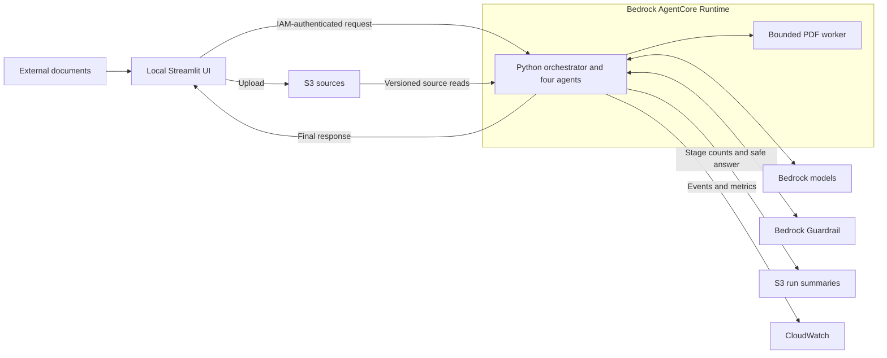

# Threat model

**Assessment date:** 11 October 2026. **Summary updated:** 12 October 2026.

**Reviewed implementation:** Security changes committed in `530a65b`, deployed as
AgentCore runtime version 12.

The assessment records **9 mitigated threats, 1 threat outside the single-owner scope,
and 2 open risks: 1 High and 1 Medium**. No owner risk acceptance is recorded.
These results describe a non-production sample and do not constitute security certification.

## Architecture and scope

The local Streamlit UI uploads sources and invokes one IAM-authenticated Bedrock
AgentCore Runtime. A Python orchestrator runs the Evidence Extractor, Analyst,
Verifier, and Synthesizer in sequence. All four use Bedrock models and exchange
typed data. The caller receives one final JSON response.

One approved IAM principal or trusted operator group owns each deployment and its data.
The UI binds to loopback. Public hosting, independent data owners sharing a deployment,
and individual high-impact decisions are outside the assessed scope. Persistent memory
and Step Functions are future architecture options.

| Trust boundary | Control and limitation |
|---|---|
| External documents → pipeline | Treat source text and metadata as untrusted. Bound loading and parsing, then screen model input. An allowed source is not necessarily truthful. |
| Workstation → AWS runtime | IAM authorization and explicit invoker-role trust. Run IDs and request fingerprints do not authenticate an end user. |
| Runtime → storage and AWS services | Scoped roles, private endpoints, isolated subnets, and private encrypted buckets. Shared prefixes belong to one trusted data scope. |
| Model response → next stage or answer | Ground excerpts, validate references, and check generated final output. Schema and citation checks do not prove semantic correctness. |
| Source/dependencies → deployed code | Pinned versions, dependency hashes, a digest-pinned fallback image, and scoped code-archive access. Protected build identities and provenance remain unverified. |

## Implemented controls

1. **Input and output safety:** Live Strands runs require a configured Guardrail.
   Questions, retrieved text and metadata, and complete or generated partial answers
   are screened. Missing or failed safety checks block publication.
2. **Evidence integrity:** Code assigns evidence IDs, checks excerpts against loaded
   text, rejects invalid claim/review references, and builds citation metadata from
   retained evidence. S3 citations preserve the version read.
3. **Run isolation:** Atomic reservations prevent reuse of an existing run ID.
   Each model call creates a fresh Agent, and the runtime admits one invocation
   per process. Reservations are retained separately from expiring results.
4. **Resource limits:** The server bounds request size, source count, downloaded bytes,
   extracted text and chunks. PDF parsing has page, time, CPU and memory limits.
   The worker isolates resource consumption; it is not an IAM or filesystem sandbox.
5. **Budget handling:** Known token usage is recorded before budget rejection.
   Exhaustion or incomplete usage accounting stops further model calls, and
   cancellation reaches the SDK. An in-flight call can still exceed the remaining budget.
6. **Data retention:** Saved stage files contain counts. Recovery state contains the
   safety-checked answer, metrics and a request fingerprint. Detailed evidence stays in
   the authorized live response. UI uploads and run artifacts expire after seven days,
   including noncurrent versions; access logs expire after 90 days.
7. **Diagnostics:** Operational stage logs remain available. Model-content callbacks
   and deployed OpenTelemetry SDK export are disabled. Account-level logging settings
   can be changed separately and need their own access and retention review.

Implementation references: [orchestrator](../src/evidence_synthesis/orchestrator.py),
[source loader](../src/evidence_synthesis/source_loader.py),
[PDF worker](../src/evidence_synthesis/pdf_reader.py),
[reference validation](../src/evidence_synthesis/validation.py),
[safety gates](../src/evidence_synthesis/safety.py),
[artifact storage](../src/evidence_synthesis/artifacts.py),
[Strands runtime](../src/evidence_synthesis/strands_runtime.py), and
[infrastructure](../infra/evidence_synthesis_infra/).

## Threat disposition

Ratings are residual assessments after the controls above, within the stated scope.
“Mitigated” does not mean the threat is impossible.

| ID | Threat | Disposition | Residual severity |
|---|---|---|---|
| T001 | Remote requests reading local files | Mitigated | Low |
| T002 | Indirect prompt injection and misleading model interpretation | Open | Medium |
| T003 | Cross-owner access through shared roles and prefixes | Outside the single-owner scope | High if multiple owners share a deployment |
| T004 | Run-ID reuse replacing saved artifacts | Mitigated | Low |
| T005 | Raw diagnostic data bypassing final-answer filtering | Mitigated | Low |
| T006 | Partial answers bypassing output safety | Mitigated | Low |
| T007 | Unbounded source loading and parsing | Mitigated | Low |
| T008 | Missing token accounting, budget retries and cancellation gaps | Mitigated | Low |
| T009 | Agent conversation history carrying into later runs | Mitigated | Low |
| T010 | Unintended access to the local UI | Mitigated for trusted loopback use | Low |
| T011 | Compromised build inputs or deployment identity | Open | High |
| T012 | Invalid downstream evidence and citation references | Mitigated | Low |

**T011 — build and deployment trust:** Hashes and version pins are implemented.
Repository protection, independent source review, isolated CI/deployment credentials,
dependency monitoring and an auditable artifact-to-deployment chain were not verified.
Closing this risk requires evidence of those controls. No specific malicious dependency
or current vulnerability is asserted.

**T002 — adversarial and semantic behavior:** Targeted safety checks passed, but broad
resistance to adaptive prompt injection and misleading sources has not been demonstrated.
A maintained evaluation set should cover conflicting evidence, malicious metadata,
disguised instructions, unsupported confidence, and citations that exist but do not
support the conclusion. Confidence calibration remains unverified.

**T003 — multiple owners:** Per-user session, run and object ownership checks are not
implemented. Separate deployments can preserve the assessed trust boundary. Shared
multi-user hosting reopens this threat and requires authenticated ownership enforcement.

## Validation and scan results

The following evidence was collected on 11 October 2026; these are dated results,
not continuous assurances.

1. **Code and infrastructure:** 179 tests passed, along with Ruff and mypy.
   Linux ARM64 packaging and strict deployment synthesis succeeded.
2. **Deployed application:** Version 12 completed the coastal fixture through the UI's
   IAM role in approximately 104 seconds. PDF parsing, versioned citations, run
   reservations, summary recovery and completed stage logs were verified.
   A source-injection test was blocked before any model invocation.
3. **Threat Modeling MCP:** Version 1.30.0 recorded code evidence for all 12 threats
   and 20 mitigations and completed the modeling workflow.
4. **ProtoShield:** Version 0.15.0-rc14 reported 0 Critical and 0 High findings.
   It reported 5 Medium and 434 Low findings, but its cfn-nag Medium counter disagrees
   with the detail: 7 warning types and 8 resource-level warnings. Checkov adds a
   finding that overlaps the runtime-log encryption warning. Treat the headline
   Medium count as unreconciled.
5. **Coverage:** ProtoShield reported no known dependency vulnerabilities, secrets or
   IAM least-privilege findings, and all 67 checked files passed MIT/copyright checks.
   Supplemental Bandit on Python 3.12 parsed all 65 Python files and found no High or
   Medium issues, covering five files skipped by ProtoShield's parser.
6. **Earlier Holmes review:** The CSR review retained one High entry with scanner
   status `suppressed`, no Medium entries and one Low entry. The High entry concerns
   the dedicated access-log destination; the Low concerns a test account identifier.
   That review predates the later threat-model changes.

Infrastructure scan observations include customer-managed log encryption, VPC flow
logs, policy complexity, and IAM/network rules. Some conflict with other analyzer
results or documented exceptions. For example, cfn-nag flags resource wildcards that
the separate IAM reviewer accepts, and flags an ICMP deny rule as an egress port range.
Existing suppressions remain part of the evidence; zero Critical/High ProtoShield
findings do not close T002 or T011.

## Report handling

Raw exports, rubric definitions, tool transcripts and detailed scan output remain local
under the Git-ignored `.threatmodel/` and `runs/` directories. This maintained summary
contains the assessment conclusions and code references without copying credential
examples, temporary download URLs or account-specific deployment identifiers.

Update the scope, threat dispositions and dated verification results when the
architecture or controls change.
